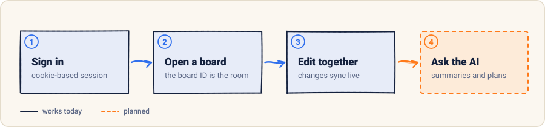
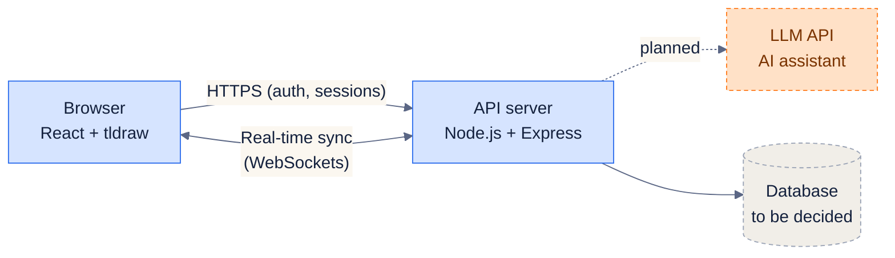

<div align="center">
  

  <p>
    <a href="https://converge-sq19.vercel.app"></a>
    
    <a href="https://github.com/mishraaviral7002/Converge/issues"></a>
  </p>
</div>

## About

Converge is a shared whiteboard for teams. You open a board, share its ID, and everyone who joins lands on the same canvas and sees each other's changes as they happen.

I started it because brainstorms and plans usually live in different tools, and the context gets lost in the move between them. The goal is for a plan to start on the same canvas the idea started on. An AI assistant that helps turn a messy board into a plan is the next thing I'm building.

**Try it:** [converge-sq19.vercel.app](https://converge-sq19.vercel.app). Sign in, open a board, and send the board ID to a friend.


## What works today

- **A real whiteboard.** The canvas is built on [tldraw](https://tldraw.dev), so drawing, writing and arranging notes feels familiar.
- **Live editing.** Several people can work on one board at the same time and see changes right away.
- **Rooms by board ID.** The same ID puts people in the same room. Nothing else to set up.
- **Sign-in before joining.** Authentication uses cookie-based sessions, so only signed-in users can enter a board.
- **Deployed.** Frontend on Vercel, backend on Render.

## What's coming

- **An AI assistant** that can suggest ideas, summarise a discussion, and expand a rough thought.
- **Board to plan.** Turning what's on the canvas into tasks and a workflow.
- **Mind maps.** Linking related ideas so the connections are visible.
- **Shared workspaces.** Grouping boards by team or project.
- **Saved boards.** Persistent storage and board history.

## How it works



Here is the same thing as a system diagram. Dashed boxes are not built yet.



## Tech stack

| Layer | Technology |
|:--|:--|
| Frontend | React, Vite, TypeScript |
| Canvas | tldraw |
| Styling | CSS / Tailwind CSS |
| Backend | Node.js, Express |
| Real-time | WebSockets / Socket.IO |
| Database | Not decided yet |
| AI | LLM API (planned) |
| Hosting | Vercel (frontend), Render (backend) |

The stack will keep changing as the project grows.


## Getting started

You need Node.js 18 or later and npm.

```bash
# clone and install
git clone https://github.com/mishraaviral7002/Converge.git
cd Converge
cd client && npm install
cd ../server && npm install
```

Create a `.env` file in each of `client` and `server`:

```bash
# server/.env
PORT=5000
CLIENT_URL=http://localhost:5173
SESSION_SECRET=replace-with-a-long-random-string

# client/.env
VITE_API_URL=http://localhost:5000
```

Then run both halves in separate terminals:

```bash
# terminal 1
cd server && npm run dev

# terminal 2
cd client && npm run dev
```

Open the address Vite prints, usually `http://localhost:5173`.

## Roadmap

- [x] Whiteboard on tldraw
- [x] Real-time multi-user editing
- [x] Rooms by board ID
- [x] Authentication and cookie-based sessions
- [x] Frontend and backend deployed
- [ ] AI assistant for ideas and summaries
- [ ] AI-generated plans, tasks and workflows
- [ ] Mind-map tools
- [ ] Shared workspaces
- [ ] Persistent storage and board history

## Contributing

Converge is early, so feedback helps a lot right now. Bug reports, ideas and suggestions are all welcome.

1. Open an [issue](https://github.com/mishraaviral7002/Converge/issues) to report a bug or suggest a feature.
2. To change code, fork the repo, make a branch, and open a pull request that says what changed and why.

## License

A license will be added once the terms are decided.

## Author

Built by [Aviral Mishra](https://github.com/mishraaviral7002). Say hello on [LinkedIn](https://www.linkedin.com/in/aviral-mishra-9ba02b348/).