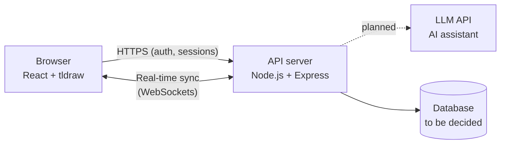

<div align="center">

# Converge

### An AI-powered collaborative whiteboard
**Think together. Build smarter.**

<p>
  <a href="https://converge-sq19.vercel.app"></a>
  
</p>

<p>
  
  
  
  
  
</p>

[Live demo](https://converge-sq19.vercel.app) · [Features](#features) · [Getting started](#getting-started) · [Roadmap](#roadmap) · [Contributing](#contributing)

</div>

---

## Overview

Converge is a shared visual workspace where people, ideas, and plans come together on one canvas. It combines real-time collaboration with AI-assisted planning, so scattered thoughts from a brainstorm can become structured, actionable outcomes without leaving the board.

Most teams brainstorm in one tool and plan in another, and the context gets lost in between. Converge closes that gap: the same space where an idea is sketched is the space where it is refined, organised, and turned into a plan.

> **Status:** Converge is under active development. The collaborative whiteboard, rooms, and authentication are working today. The AI features described below are on the roadmap.

## Live demo

Try it here: **[converge-sq19.vercel.app](https://converge-sq19.vercel.app)**

Sign in, open a board, and share its board ID with someone else. Anyone who joins with the same ID lands in the same room and sees changes as they happen.

## Features

### Available now

| Feature | Description |
|:--|:--|
| **Interactive whiteboard** | A full canvas for sketching, writing, and arranging ideas, built on [tldraw](https://tldraw.dev). |
| **Real-time collaboration** | Multiple people edit the same board at the same time and see each other's changes live. |
| **Room-based boards** | A board ID defines a room. Share the ID and collaborators join the same space. |
| **Secure sign-in** | Authentication with cookie-based sessions, so only signed-in users can join a board. |

### Planned

| Feature | Description |
|:--|:--|
| **AI-assisted brainstorming** | Generate ideas, summarise discussions, and explore possible solutions from what is on the board. |
| **Intelligent planning** | Turn brainstormed ideas into structured plans, tasks, and workflows. |
| **Visual mind mapping** | Connect related concepts and make the relationships between ideas visible. |
| **Shared workspaces** | Organise boards around teams, projects, and goals. |

## How it works



1. A user signs in and receives a cookie-based session.
2. They open a board by ID, which places them in that board's room.
3. Edits are synchronised between everyone in the room in real time.
4. Planned: an AI assistant reads the board's content and helps summarise, expand, and organise it.

## Tech stack

| Layer | Technology |
|:--|:--|
| Frontend | React, Vite, TypeScript |
| Canvas | tldraw |
| Styling | CSS / Tailwind CSS |
| Backend | Node.js, Express |
| Real-time | WebSockets / Socket.IO |
| Database | To be determined |
| AI | LLM API integration (planned) |
| Hosting | Vercel (frontend), Render (backend) |

The stack will continue to evolve as the project grows.

## Getting started

### Prerequisites

- Node.js 18 or later
- npm (or your preferred package manager)

### Installation

```bash
# 1. Clone the repository
git clone https://github.com/mishraaviral7002/Converge.git
cd Converge

# 2. Install dependencies for the client and the server
cd client && npm install
cd ../server && npm install
```

### Configuration

Create a `.env` file in each of the `client` and `server` folders. Typical values:

```bash
# server/.env
PORT=5000
CLIENT_URL=http://localhost:5173
SESSION_SECRET=replace-with-a-long-random-string

# client/.env
VITE_API_URL=http://localhost:5000
```

### Run locally

```bash
# Terminal 1: start the API server
cd server && npm run dev

# Terminal 2: start the frontend
cd client && npm run dev
```

Then open the URL printed by Vite, usually `http://localhost:5173`.

## Roadmap

- [x] Interactive whiteboard on tldraw
- [x] Real-time multi-user editing
- [x] Room-based boards
- [x] Authentication and cookie-based sessions
- [x] Deployed frontend and backend
- [ ] AI assistant for brainstorming and summaries
- [ ] AI-generated plans, tasks, and workflows
- [ ] Mind-map tools for linking ideas
- [ ] Shared workspaces for teams and projects
- [ ] Persistent storage and board history

## Contributing

Converge is in its early stages, and feedback is genuinely useful right now. Ideas, bug reports, and suggestions are all welcome.

1. Open an [issue](https://github.com/mishraaviral7002/Converge/issues) to report a bug or propose a feature.
2. For code changes, fork the repository, create a branch, and open a pull request describing what you changed and why.

## License

A license will be added once the licensing terms for the project have been decided.

## Author

Built by **Aviral Mishra**.

[LinkedIn](https://www.linkedin.com/in/aviral-mishra-9ba02b348/) · [GitHub](https://github.com/mishraaviral7002)
